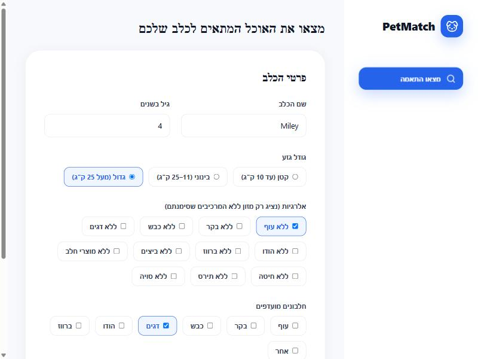
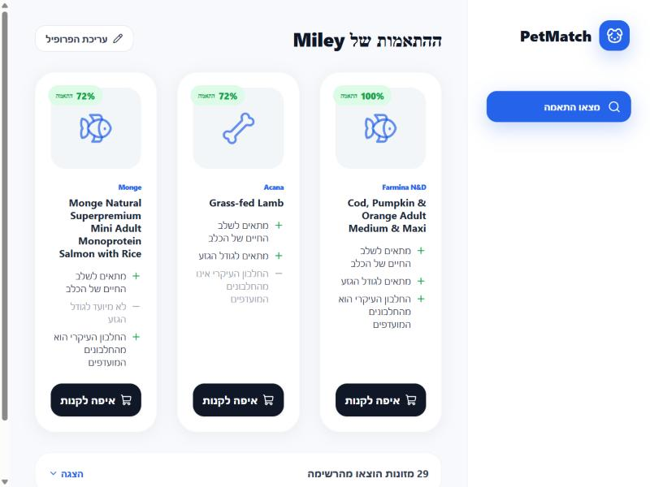
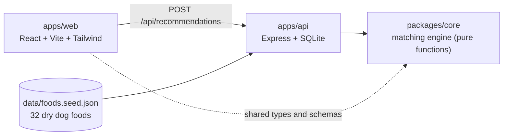

# PetMatch

PetMatch answers one question: **which food suits this specific pet, and why?**
The owner fills in a short dog profile and gets a ranked list of dry foods, each with the
reasons it fits or does not fit and a link to compare prices. Foods that contain an allergen
are not hidden: they are listed separately with the reason, so the filter can be seen working.

The interface is in Hebrew (right to left). Code, commits and docs are in English.

**Status:** v1 is complete and runs locally. It is not deployed; see [docs/decisions.md](docs/decisions.md).

| 1. Dog profile                             | 2. Ranked matches                        |
| ------------------------------------------ | ---------------------------------------- |
|  |  |

## How it works

1. The visitor fills in name, age, breed size, allergies, preferred proteins and a grain-free preference.
   The profile is kept in the browser (`localStorage`); nothing personal is stored on the server.
2. The web app sends the profile to the API (`POST /api/recommendations`).
3. The API reads the catalog and calls the matching engine in `packages/core`:
   - **Hard filters** remove foods for another species and foods containing an allergen from the profile.
   - **Scoring** gives each remaining food points for life-stage fit, breed-size fit, preferred protein and the
     grain-free preference, then normalises the result to 0-100. The weights live in one object
     (`DEFAULT_WEIGHTS`) and every score comes with its reasons.
4. The web app shows the ranked matches, the excluded foods with their reasons, and a "not veterinary advice" notice.

## Architecture



- `packages/core` has no HTTP or database code, so it is easy to test. It also derives each food's allergens from
  its ingredient list, so allergens are never typed by hand.
- `apps/api` loads the catalog from `apps/api/data/foods.seed.json` into SQLite on every start and serves three
  endpoints: `GET /health`, `GET /api/foods`, `POST /api/recommendations`. All input is validated with Zod.
- `apps/web` is the React app. Every UI string is in `apps/web/src/i18n/he.ts`.

## Run it locally

You need Node.js 22 or newer.

```bash
npm install
npm run dev
```

Then open http://localhost:5173. `npm run dev` starts the API on port **3100** and the web app on port 5173,
and points the web app at the API. To use another API port: `PORT=4000 npm run dev` (PowerShell:
`$env:PORT=4000; npm run dev`). Stop both with Ctrl+C.

To run the pieces on their own, see `apps/api/.env.example` and `apps/web/.env.example`
(`npm run dev -w @petmatch/api`, `npm run dev -w @petmatch/web`).

## Test it

```bash
npm test            # unit and request-level tests in every package
npm run lint        # ESLint
npm run typecheck   # TypeScript, strict, in every package
npm run format      # Prettier (writes files)
```

A single package: `npm test -w @petmatch/core` (also `@petmatch/api`, `@petmatch/web`).

To check a running API (for example the one `npm run dev` started):

```bash
npm run smoke -- http://localhost:3100
```

It exits 0 when `/health` is healthy and a typical dog gets at least 3 matches. Continuous integration runs
lint, type check and tests on every push and pull request.

## The catalog

32 dry dog foods from nine brands, entered by hand from the manufacturers' published ingredient lists.
[apps/api/data/SOURCES.md](apps/api/data/SOURCES.md) lists the source page of each food and notes that some
lists come from UK, Irish, EU or UAE sites, so the Israeli formulation may differ. Buy links are price-comparison
searches on zap.co.il; no prices are stored.

## Disclaimer

PetMatch is not veterinary advice. For medical conditions, ask your vet.

## What is next

- Deployment to a public URL, when needed (see [docs/decisions.md](docs/decisions.md)).
- Optional: a short AI-written explanation per recommendation, and affiliate links.
- More foods with a protein other than chicken, so allergic dogs get a wider choice.

Design: [docs/design.md](docs/design.md) · Implementation plan: [docs/plan.md](docs/plan.md)
